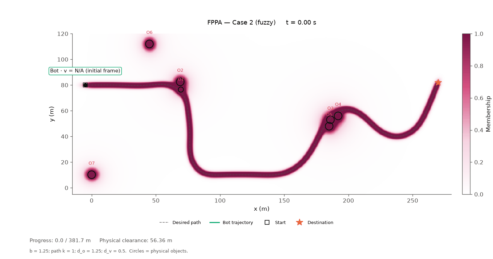
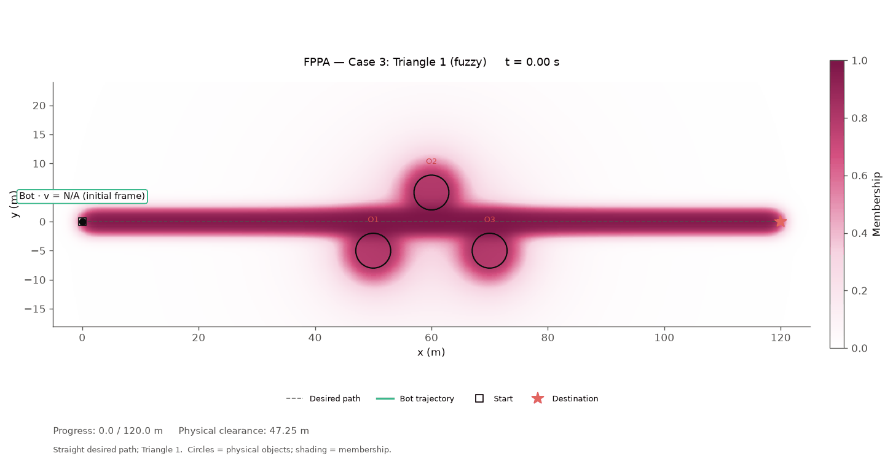
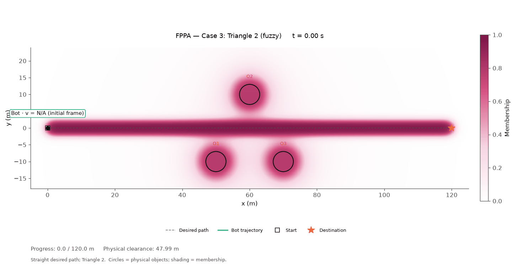
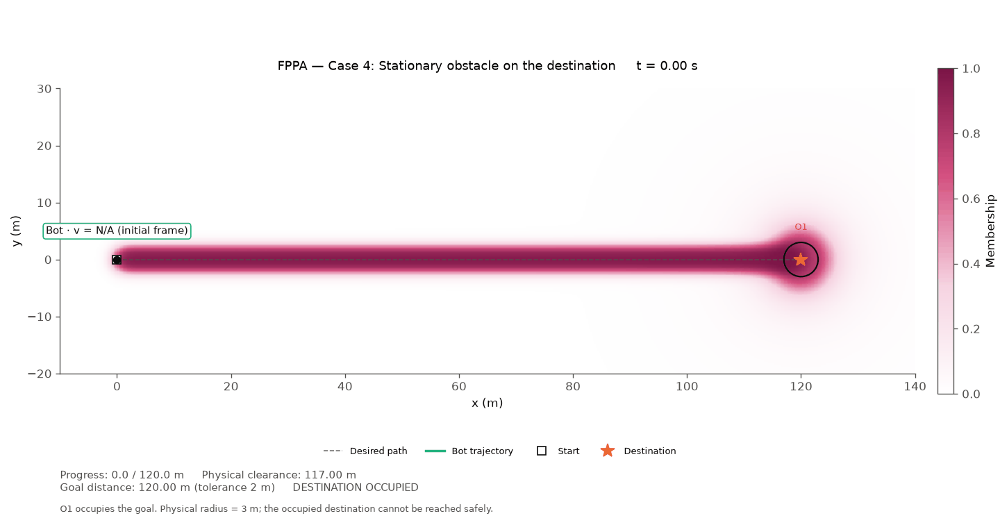
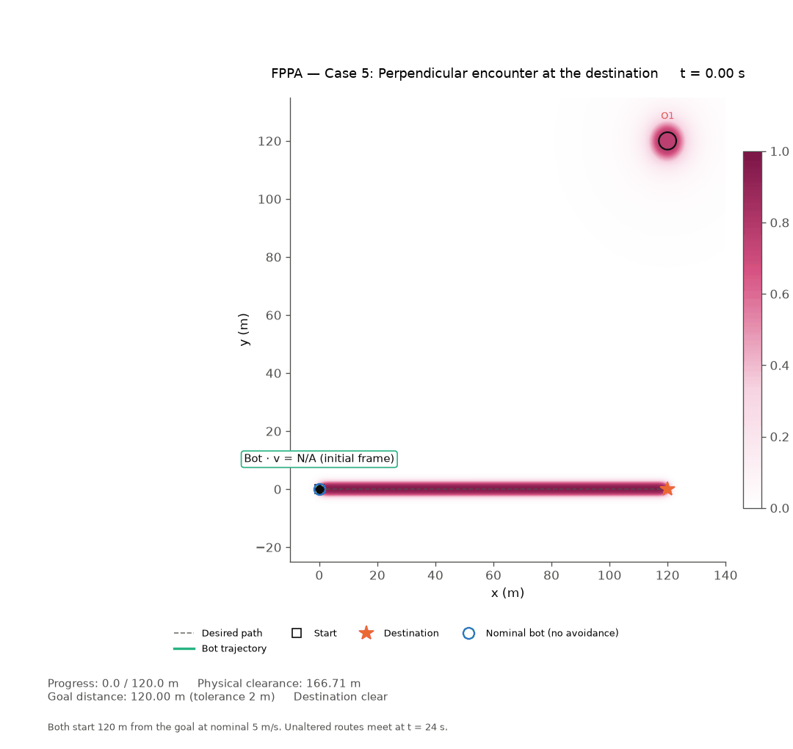
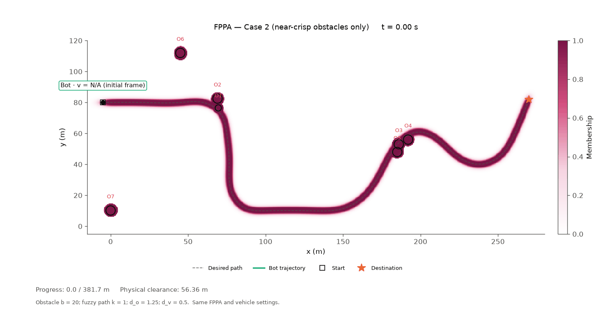
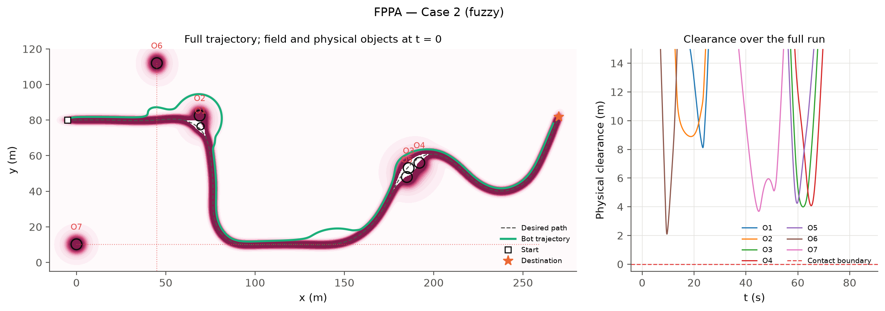
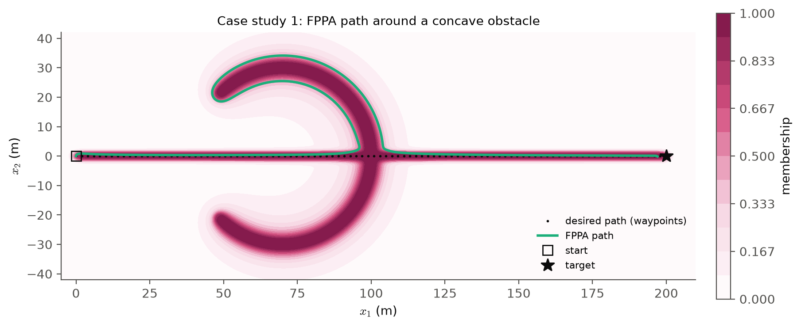

# Fuzzy Set–Based Autonomous Navigation

A from-scratch Python implementation of the **Fuzzy Path Planning Algorithm (FPPA)** from
E. A. Rastkhiz, H. Schwartz and I. Lambadaris, *A fuzzy set-based methodology for autonomous navigation*,
Fuzzy Sets and Systems 518 (2025) 109485.

Obstacles and the global path are modelled as fuzzy sets and merged into one membership field with a
Yager t-conorm. The vehicle then follows a contour line of that field, so path tracking and obstacle
avoidance come from a single gradient update law.

<p align="center">
  
</p>

## Highlights

- **Vectorised fuzzy-set engine** (`fppa/`): bell and Gaussian base membership functions, velocity-inflated
  atomic obstacles, fuzzy waypoint chains, and m-ary Yager unions. Every quantity comes with an **exact
  analytic gradient**, which agrees with finite differences to a relative error of about 2·10⁻⁹.
- **Planner**: contour-level selection, an obstacle-aware speed bound, and the normal + tangential update
  rule (Algorithm 1), plus unicycle signals (speed, heading, acceleration, yaw rate) recovered from the path.
- **Extensions**: a range-preserving `softmin` saturation, velocity-aware obstacle inflation, and safe goal
  capture for destinations that an obstacle may occupy.
- **Reproducible experiments**: six animated scenarios, 37 static figures and JSON result files, all
  regenerated by one command and covered by a unit-test suite.
- **Technical slides**: a 32-page Beamer deck ([`slides/fppa_slides.pdf`](slides/fppa_slides.pdf)) that
  walks through the mathematics and the reproduced case studies.

## Method

For obstacle atoms $O_i$ with centres $c_i(t)$ and waypoint atoms $W_j$:

$$
\mu_{\tilde O_i}(x)=\tanh\!\big(\|\Lambda_i^{-1}(x-c_i)\|^{-2b}\big),\qquad
\mu_{W_j}(x)=\exp\!\big(-\tfrac12\|\Gamma_j^{-1}(x-p_j)\|^2\big)
$$

The environment is the Yager union of all atoms, $\mu_E=\operatorname{sat}\big(\sum_i\mu_{\tilde O_i}^p+\sum_j\mu_{W_j}^p\big)^{1/p}$.
The obstacle scale $\Lambda_i$ is inflated along each obstacle's velocity. At each step the planner picks a target
contour and a speed limit from the local obstacle membership:

$$
\mu_{th}=\alpha\,(1-\mu_{\tilde O})^{d_o},\qquad v_{max}=v_m\,(1-\mu_{\tilde O})^{d_v}
$$

It then moves toward that contour and along it:

$$
\Delta x_k=-\eta_n(\mu_E-\mu_{th})\nabla\mu_E\;+\;v_{max}t_s\,\frac{R(\pi/2)\nabla\mu_E}{\|\nabla\mu_E\|}.
$$

The first term is gradient descent on $V=\tfrac12(\mu_E-\mu_{th})^2$. The second term is orthogonal to the gradient,
so it moves the vehicle along the level set without changing $V$ to first order.

## Scenarios

| | |
|:---:|:---:|
|  |  |
| **Tight triangle**: three discs 5 m off-axis. The vehicle passes all three on the same side and finishes in 28.0 s with 2.3 m clearance. | **Wide triangle**: discs 10 m off-axis. The vehicle weaves between them and finishes in 24.5 s with 4.9 m clearance. |
|  |  |
| **Occupied destination**: an obstacle sits on the goal. The planner follows its contour and never enters it. The run reports `destination_occupied` rather than a false success. | **Crossing obstacle**: the obstacle is timed to reach the goal at the same moment as the nominal vehicle (blue ring). FPPA slows down, detours and reaches the goal at 25.45 s with no collision. |

<p align="center">
  
</p>

**Near-crisp obstacles.** The Case 2 course with the obstacle bell exponent raised to *b* = 20, so each obstacle
approaches a crisp disc. Membership now rises sharply at the boundary, and the steep gradients produce large
normal corrections close to the obstacles; the vehicle makes contact with O2 at about 21 s.

Each animation also has a matching static trajectory/clearance chart (`<scenario>_path.png`) and a
speed/heading/acceleration/yaw-rate chart (`<scenario>_signals.png`). Circles show physical radii; the shading
shows fuzzy membership. Crash counters count each new physical contact once, using every simulation sample, not
just the rendered frames.

## Findings

### Static and moving obstacles (Case 2)



A 380 m curved route with five static and two moving obstacles. The vehicle completes the route in **86.5 s**
with a minimum physical clearance of **2.1 m**. When O7 passes 3.7 m away, the obstacle membership around the
vehicle rises to 0.35 and the speed bound slows it to about 4.05 m/s. It speeds back up to about 4.9 m/s once O7 is clear.

### Concave obstacle (Case 1)



A 270° arc of 97 atoms sits across a 200 m straight path, forming a pocket that opens towards the vehicle. The
vehicle follows a contour of the environment out of the pocket and around the outside of the arc, rejoins the path
and reaches the goal in **78.3 s**.

## Project structure

```
fppa/                     core library
  fuzzy.py                BMFs, saturations (exact / tanh / softmin), Yager t-conorm with gradients
  environment.py          FuzzyObstacles, FuzzyPath, FuzzyEnvironment
  planner.py              FPPA update law, simulation loop, unicycle signals
experiments/
  scenarios.py            all case-study geometries
  make_figures.py         analysis figures (f*.png) and figures/results.json
  make_paper_figures.py   paper-faithful reproductions (paper_*.png) and figures/results_paper.json
  make_animations.py      GIFs, per-scenario charts and figures/animation_results.json
  make_all.py             runs all three generators
  animations.py, static_charts.py, style.py   rendering helpers
tests/                    gradient, membership, simulation, crash-counter and renderer tests
figures/                  generated GIFs, PNGs and JSON results
slides/                   Beamer source and compiled PDF
```

## Usage

```bash
python3 -m pip install -r requirements.txt

python3 -m unittest                                  # run the test suite
python3 -m experiments.make_all                      # regenerate every figure, GIF and result file
python3 -m experiments.make_all --static-only        # same, but keep the existing GIFs
python3 -m experiments.make_animations --scenes case5_crossing_destination   # one scenario
cd slides && pdflatex fppa_slides.tex && pdflatex fppa_slides.tex           # rebuild the slides
```

The library can also be used directly:

```python
import numpy as np
from fppa import FuzzyObstacles, FuzzyPath, FuzzyEnvironment, FPPAParams, run_fppa

path = FuzzyPath(np.c_[np.linspace(0, 120, 61), np.zeros(61)], sigma=1.5, gamma=0.75)
obs = FuzzyObstacles([[60, 0]], lam=3, r=1.25, vel=[[0, 1]], delta=0.1, b=1.25)
env = FuzzyEnvironment(obs, path, p=1, sat="softmin")
log = run_fppa(env, path.w[0], FPPAParams())       # dict of trajectory, memberships, speed bounds, timings
```

## Modelling choices

Where the paper leaves details open, this implementation makes the following choices:

- The Case 1 path runs along x₂ = 0, as in the paper's Fig. 6.
- The Case 2 global path is digitised from Fig. 11 and smoothed with a cubic spline. Moving-obstacle directions
  are O6 = (0, −3) m/s and O7 = (3, 0) m/s, since the paper gives speeds only.
- Cases 2 and 3 reuse b = 1.25 and γ = 0.75 from Case 1.
- Each waypoint atom's covariance (eq. 10) is H D Hᵀ, with the segment direction as its principal axis.
- The environment is evaluated as one m-ary union over all atoms (Remark 1).
- The contours of μ_E are closed curves, so runs stop once the projection onto the path is within 1.5 segments of
  the end. Destination scenarios instead require the vehicle to be within 2 m of the goal, with both the vehicle and
  the goal clear of obstacles.

## Reference

```bibtex
@article{rastkhiz2025fuzzy,
  title   = {A fuzzy set-based methodology for autonomous navigation},
  author  = {Rastkhiz, E. A. and Schwartz, H. and Lambadaris, I.},
  journal = {Fuzzy Sets and Systems},
  volume  = {518},
  pages   = {109485},
  year    = {2025}
}
```
